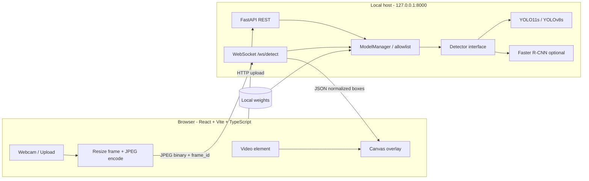

# PLAN — Tomato Leaf Detector

> Đồ án môn học: **Phát hiện vùng lá bệnh trên ảnh thực địa cây cà chua bằng web AI chạy local**.
>
> Trạng thái: bản kế hoạch thiết kế. Các chỉ số chất lượng/tốc độ chỉ được điền sau khi chạy thí nghiệm; không ghi số liệu giả định như kết quả thật.

## 1. Mục tiêu và ranh giới bài toán

Xây dựng ứng dụng web chạy trên máy cá nhân để nhận diện lá cà chua khỏe/bệnh từ ảnh upload hoặc webcam. Backend chạy mô hình object detection, trả về bounding box, nhãn lớp và confidence; frontend vẽ box trực tiếp lên ảnh/video.

### Trong phạm vi

- Chín lớp lá cà chua được giữ lại từ bản **PlantDoc Object Detection Dataset**.
- Chuẩn hóa CSV annotation → định dạng YOLO và COCO; thống kê, kiểm tra ảnh/hộp, khử trùng lặp gần đúng và tạo split tái lập.
- Fine-tune mô hình chính YOLO11s từ trọng số COCO.
- Web local gồm upload ảnh, live webcam preview, đổi model có sẵn, chỉnh ngưỡng confidence/NMS, thống kê latency/FPS, lưu snapshot đã vẽ box.
- Đánh giá bằng mAP@0.5, mAP@0.5:0.95, AP từng lớp, precision/recall, confusion/error analysis và latency.
- Hoạt động inference trên CPU; GPU là tùy chọn. Nếu máy chỉ có CPU, ưu tiên huấn luyện trên Colab/Kaggle hoặc máy có GPU, sau đó chép checkpoint về máy local.

### Ngoài phạm vi

- Phân đoạn chính xác từng đốm bệnh (segmentation), định lượng diện tích tổn thương hoặc mức độ bệnh.
- Đưa ra phác đồ điều trị, liều thuốc hoặc chẩn đoán nông học chắc chắn.
- Khẳng định hệ thống đã tổng quát hóa tốt trên vườn cà chua Việt Nam chỉ dựa vào ảnh PlantDoc lấy từ Internet.
- Gửi ảnh/video đến dịch vụ cloud. Mọi suy luận mặc định chạy trên localhost.

## 2. Quyết định kỹ thuật đã chốt

| Hạng mục | Quyết định | Lý do / ràng buộc |
|---|---|---|
| Nhiệm vụ AI | Object detection, bounding box ở mức lá/cụm lá | Phù hợp với annotation có sẵn của PlantDoc detection. Box không khoanh từng đốm tổn thương. |
| Mô hình chạy live | **YOLO11s**, fine-tune từ `yolo11s.pt`, `imgsz=640` | Cân bằng độ chính xác/tốc độ, dễ train/infer và tích hợp. |
| Baseline | YOLOv8s; Faster R-CNN ResNet50-FPN v2 | So sánh một YOLO đời trước và mô hình two-stage. Chỉ là phần nghiên cứu mở rộng nếu tài nguyên hạn chế. |
| Backend | Python + FastAPI + Uvicorn | Dùng chung inference cho upload, webcam và CLI. |
| Giao tiếp live | WebSocket; JPEG binary từ browser, JSON kết quả về | Tránh tạo request HTTP mới cho từng frame; giới hạn frame đang xử lý để tránh dồn trễ. |
| Frontend | React + TypeScript + Vite + Canvas overlay | Có thể tách phần video khỏi lớp box, dễ kiểm soát tọa độ và FPS. |
| Dataset | PlantDoc Object Detection, lọc 9 lớp cà chua | Không tự tạo annotation phân loại mới khi chưa có dữ liệu gán nhãn. |
| Test set | Giữ split `TEST` công bố của bản tải về | Không dùng test để chọn checkpoint, confidence hoặc siêu tham số. |
| Runtime | Mặc định bind `127.0.0.1` | Hạn chế vô tình công khai camera/API ra LAN. |
| Config | YAML trong `configs/`, biến môi trường `TDET_*` | Không hard-code đường dẫn/checkpoint/threshold trong nhiều module. |
| Kiểm thử | pytest + Vitest | Test parser, tọa độ bbox, API, WebSocket và protocol frontend. |

### Quy tắc chọn model cuối

1. Model triển khai ban đầu là `yolo11s_coco` nếu có checkpoint đã train và vượt qua kiểm thử smoke.
2. Chỉ đổi `default_model` sau khi có kết quả validation tái lập: model mới tăng ít nhất **2 điểm phần trăm mAP@0.5:0.95** so với YOLO11s và đáp ứng yêu cầu độ trễ trên cùng thiết bị, cùng `imgsz`, cùng ngưỡng đo.
3. Không chọn model dựa trên test set. Chỉ mở test một lần sau khi đóng băng checkpoint và cấu hình.
4. Nếu chưa có checkpoint, giao diện phải hiển thị `model unavailable`/`chưa có trọng số`, không giả vờ có dự đoán. Backend vẫn phải khởi động được để xem docs/API/health.

## 3. Dataset và nhãn

### 3.1 Nguồn

- PlantDoc paper: Davinder Singh, Naman Jain, Pranjali Jain, Pratik Kayal, Sudhakar Kumawat, Nipun Batra, *PlantDoc: A Dataset for Visual Plant Disease Detection*, CoDS-COMAD 2020, DOI: <https://doi.org/10.1145/3371158.3371196>.
- Bản object detection: <https://github.com/pratikkayal/PlantDoc-Object-Detection-Dataset>.
- Repository ghi giấy phép CC BY 4.0. Hãy giữ trích dẫn/ghi công và kiểm tra các điều khoản kèm theo trước khi phân phối lại dữ liệu. Không đưa toàn bộ ảnh dataset vào Git repository dự án.

### 3.2 Danh sách lớp đích

`configs/classes.yaml` là **nguồn sự thật duy nhất** cho `class_id`, tên gốc, slug và tên tiếng Việt trên giao diện. Trước khi xử lý toàn bộ dữ liệu, chương trình phải đọc `train_labels.csv`/`test_labels.csv` thực tế và xác nhận đúng tên lớp; không dựa vào việc viết hoa/thường hay dấu câu đã được giả định.

| ID | Tên lớp chuẩn hóa trong dự án | Slug | Tên hiển thị tiếng Việt |
|---:|---|---|---|
| 0 | `Tomato Early blight leaf` | `early_blight` | Úa sớm (đốm vòng) |
| 1 | `Tomato Septoria leaf spot` | `septoria_leaf_spot` | Đốm lá Septoria |
| 2 | `Tomato leaf bacterial spot` | `bacterial_spot` | Đốm vi khuẩn |
| 3 | `Tomato leaf late blight` | `late_blight` | Mốc sương / úa muộn |
| 4 | `Tomato leaf mosaic virus` | `mosaic_virus` | Virus khảm |
| 5 | `Tomato leaf yellow virus` | `yellow_virus` | Virus vàng lá |
| 6 | `Tomato mold leaf` | `leaf_mold` | Mốc lá |
| 7 | `Tomato two spotted spider mites leaf` | `spider_mites` | Nhện hai chấm |
| 8 | `Tomato leaf` | `healthy` | Lá khỏe |

**Chốt semantics:** annotation box mô tả một lá hoặc cụm lá mang nhãn. Tên tiếng Việt là nhãn hiển thị phục vụ học thuật, không thay cho chẩn đoán chuyên gia. Nếu parser phát hiện class trong CSV không khớp mapping, dừng bằng lỗi giải thích rõ; không âm thầm bỏ/ánh xạ sang lớp khác.

### 3.3 Pipeline xử lý

1. `tdet data inspect`: đọc CSV, kiểm kê ảnh/box/class, kiểm tra đường dẫn ảnh, kích thước, giá trị tọa độ và nhãn chưa ánh xạ.
2. Parse CSV thành bản ghi chuẩn hóa `ImageRecord` và `BoxRecord`.
3. Chỉ giữ box thuộc 9 lớp cà chua; giữ ảnh nếu còn ít nhất một box đích; ghi log số ảnh/box bị bỏ.
4. Loại/ghi báo cáo ảnh hỏng, box đảo tọa độ, box ngoài ảnh, box có diện tích bằng 0; chỉ clip tọa độ khi chính sách rõ ràng và log số trường hợp.
5. Tạo hash ảnh và pHash để phát hiện bản sao/gần trùng. Gom ảnh có quan hệ trùng vào cùng một group; lưu bảng mapping group.
6. Giữ nguyên danh sách `TEST` của dataset nguồn làm tập test chính thức. Nếu ảnh train gần trùng test, loại bản trùng khỏi train/val để tránh rò rỉ, không sửa nhãn hay thay ảnh trong TEST.
7. Tách validation từ TRAIN bằng split theo group. Do ảnh có thể mang nhiều lớp, dùng chiến lược cân bằng đa nhãn ở mức nhóm hoặc thử nhiều seed có kiểm tra phân bố lớp; không để group trùng chia qua train/val. Seed mặc định `42`.
8. Xuất YOLO: `class_id x_center y_center width height`, tọa độ chuẩn hóa theo width/height ảnh. Xuất COCO JSON tương ứng cho Faster R-CNN/evaluator.
9. Lưu `data/splits/train.txt`, `val.txt`, `test.txt`, báo cáo thống kê và metadata split để chạy lại được.
10. Sinh montage xem ảnh có box chồng lên ảnh gốc; người làm đồ án kiểm tra trực quan trước khi train.

### 3.4 Điều bắt buộc phải báo cáo

- Số ảnh và box theo split; số ảnh có nhiều hơn một box; số ảnh bị loại và lý do.
- Số lượng từng lớp theo split và cảnh báo lớp hiếm/không có mẫu trong test.
- Số nhóm near-duplicate, số mẫu bị loại khỏi train/val do trùng với TEST.
- Sự khác nhau về nguồn/điều kiện ảnh giữa PlantDoc và webcam thực địa.

## 4. Cấu hình train và thiết kế thí nghiệm

### 4.1 Cấu hình mặc định để tạo MVP

| Tham số | Giá trị ban đầu |
|---|---|
| Model | `yolo11s.pt` (COCO-pretrained) |
| Classes | 9 lớp, thứ tự theo `configs/classes.yaml` |
| Image size | 640 |
| Epoch | 100–200 với early stopping; ghi rõ giá trị thực tế trong `meta.json` |
| Patience | 25–30 |
| Batch | Chọn theo RAM/VRAM; không mặc định ép batch 16 trên CPU |
| Optimizer | Theo mặc định Ultralytics ở vòng MVP; chỉ thay đổi có ghi trong config |
| Seed | `42` cho lần chạy MVP |
| Chọn checkpoint | mAP@0.5:0.95 trên validation; lưu `best.pt` và metadata |
| Device | GPU nếu có; CPU chỉ dùng smoke-test/huấn luyện nhỏ nếu thời gian cho phép |

Huấn luyện thật có thể được thực hiện trên Colab/Kaggle khi máy local không có GPU. Chép **checkpoint của chính thí nghiệm** vào `weights/<exp_id>/best.pt` để inference trên local. Không yêu cầu ứng dụng tải model hoặc dataset từ Internet khi khởi động.

### 4.2 Ma trận nghiên cứu (mở rộng)

| Exp ID | Kiến trúc | Khởi tạo | Epoch mục tiêu | imgsz |
|---|---|---|---:|---:|
| `yolo11s_coco` | YOLO11s | COCO pretrained | 200 | 640 |
| `yolo11s_scratch` | YOLO11s | random initialization | 200 | 640 |
| `yolov8s_coco` | YOLOv8s | COCO pretrained | 200 | 640 |
| `yolov8s_scratch` | YOLOv8s | random initialization | 200 | 640 |
| `frcnn_r50v2_coco` | Faster R-CNN ResNet50-FPN v2 | COCO pretrained | 100 | 640/short-side policy được ghi rõ |
| `frcnn_r50v2_scratch` | Faster R-CNN ResNet50-FPN v2 | random initialization | 100 | cùng policy với baseline |

Mỗi cấu hình có thể chạy seed `0, 1, 2` để tính trung bình và độ lệch chuẩn. Đây là **ma trận đầy đủ, không phải điều kiện để hoàn thành MVP**. Khi tài nguyên hạn chế, ưu tiên đúng thứ tự: (1) YOLO11s pretrained, (2) evaluation hợp lệ, (3) web app live, (4) YOLOv8s baseline, (5) Faster R-CNN và scratch. Việc train scratch trên dataset nhỏ có thể cho kết quả kém hơn; vẫn báo cáo trung thực.

### 4.3 Công bằng khi so sánh

- Dùng cùng split và cùng class mapping.
- Chọn checkpoint/threshold chỉ bằng validation.
- Dùng evaluator chung cho các model; không trộn metric lấy từ pipeline khác nhau.
- Báo cáo `mAP@0.5`, `mAP@0.5:0.95`, AP từng lớp, precision, recall, số box FP/FN theo định nghĩa rõ, confusion/error analysis và latency P50/P95.
- Đo latency trên cùng thiết bị, phiên bản phần mềm, kích thước ảnh, batch và trạng thái warm-up; phân biệt **inference latency** với end-to-end webcam latency.
- Chỉ chạy test cuối sau khi chọn model; không điều chỉnh theo kết quả test.
- Bootstrap confidence interval là phần nâng cao nếu số mẫu test cho phép. Không suy diễn quá mức khi test cà chua ít.

## 5. Kiến trúc hệ thống



### 5.1 Luồng upload ảnh

1. Frontend gửi ảnh qua `POST /api/detect` bằng multipart form.
2. Backend kiểm tra dung lượng, định dạng và giải mã ảnh an toàn.
3. `ModelManager` lấy detector từ allowlist theo `model_id`, đảm bảo model sẵn sàng và serialize truy cập nếu backend/device cần.
4. Detector trả detections với `class_id`, `class_name`, `score`, box chuẩn hóa `[x1,y1,x2,y2]` trong khoảng `[0,1]`.
5. Frontend vẽ box/label, hiển thị confidence và tổng số phát hiện.

### 5.2 Luồng webcam live preview

1. Browser yêu cầu quyền camera qua `getUserMedia`; camera chỉ mở khi người dùng nhấn Start.
2. Mỗi frame lấy từ video được vẽ lên canvas ẩn, resize bảo toàn tỷ lệ với cạnh dài không quá 640 px, rồi encode JPEG (chất lượng cấu hình khoảng 0.7).
3. Client gửi gói nhị phân `uint32 big-endian frame_id` + bytes JPEG. Giữ tối đa một frame đang bay; nếu server bận, bỏ frame cũ và chỉ xử lý frame mới nhất được giữ trong queue một phần tử.
4. Server giải mã và infer ngoài event loop (thread pool hoặc executor phù hợp); luôn trả lại `frame_id` nhận được.
5. Client bỏ kết quả cũ hơn frame mới nhất đã vẽ. Dùng normalized bbox và tính chính xác vùng video thực tế đang hiển thị khi `object-fit: contain`/letterbox.
6. Khi Stop hoặc rời trang, đóng track camera, dừng gửi frame và đóng WebSocket.

### 5.3 Giao thức WebSocket

- Endpoint: `/ws/detect`.
- Client → server (text, lúc kết nối và mỗi lần đổi thiết lập):

```json
{"type":"config","model":"yolo11s_coco","conf":0.25,"iou":0.5,"imgsz":640,"max_det":50,"agnostic_nms":false}
```

- Client → server (binary): 4 byte `frame_id` unsigned big-endian + JPEG bytes. Gói nhỏ hơn 4 byte hoặc JPEG không giải mã được phải trả lỗi protocol.
- Server → client (text JSON):

```json
{
  "type": "result",
  "frame_id": 128,
  "model": "yolo11s_coco",
  "image": {"width": 640, "height": 480},
  "inference_ms": 18.7,
  "detections": [
    {"class_id": 3, "class_name": "late_blight", "score": 0.81, "box": [0.12, 0.20, 0.55, 0.77]}
  ]
}
```

Số trong ví dụ là minh họa giao thức, **không phải kết quả đo của mô hình**. `box` là xyxy chuẩn hóa theo kích thước ảnh JPEG đã gửi. Lỗi trả dạng `{"type":"error","code":"INVALID_IMAGE|MODEL_NOT_FOUND|PAYLOAD_TOO_LARGE|INFERENCE_FAILED","message":"..."}`; từng message chỉ có một `code` thực tế.

## 6. Hợp đồng API

| Method | Route | Hành vi |
|---|---|---|
| `GET` | `/api/health` | Health, device và model đã nạp; không trả đường dẫn nhạy cảm |
| `GET` | `/api/classes` | 9 class theo `configs/classes.yaml` |
| `GET` | `/api/models` | Model id được allowlist, available/unavailable và metric nếu có |
| `POST` | `/api/detect` | Multipart ảnh; query `model`, `conf`, `iou`, `imgsz`, `max_det` |
| `WS` | `/ws/detect` | Webcam live preview theo protocol mục 5.3 |
| `GET` | `/` | Frontend build trong production; chế độ dev dùng Vite |

**Yêu cầu:** response lỗi có schema nhất quán; validate conf/iou trong `[0,1]`, giới hạn `imgsz` vào tập giá trị được hỗ trợ, giới hạn file/frame bytes và `max_det`; API không cho client truyền đường dẫn checkpoint bất kỳ.

## 7. Cây thư mục mục tiêu

```text
tomato-leaf-detector/
├── README.md
├── PLAN.md
├── AGENT.md
├── PROMPT.md
├── LICENSE
├── pyproject.toml
├── requirements.txt
├── requirements-train.txt
├── requirements-dev.txt
├── .env.example
├── .gitignore
├── .github/workflows/ci.yml
├── configs/
│   ├── classes.yaml
│   ├── data.yaml
│   ├── eval.yaml
│   ├── app.yaml
│   └── experiments/
│       ├── yolo11s_coco.yaml
│       ├── yolo11s_scratch.yaml
│       ├── yolov8s_coco.yaml
│       ├── yolov8s_scratch.yaml
│       ├── frcnn_r50v2_coco.yaml
│       └── frcnn_r50v2_scratch.yaml
├── data/                         # dữ liệu thật được git-ignore
│   ├── README.md
│   ├── raw/plantdoc/
│   ├── interim/
│   ├── processed/
│   │   ├── tomato_yolo/images/{train,val,test}/
│   │   ├── tomato_yolo/labels/{train,val,test}/
│   │   ├── tomato_yolo/dataset.yaml
│   │   └── tomato_coco/annotations/{train,val,test}.json
│   ├── splits/                   # chỉ các file split/metadata được theo dõi bằng Git
│   └── samples/                  # ảnh tự chụp/có giấy phép rõ ràng
├── src/tomato_det/
│   ├── cli.py
│   ├── common/{classes.py,types.py,config.py,paths.py,seed.py,logging.py,device.py,meta.py,viz.py}
│   ├── data/{inspect.py,parse_plantdoc.py,tomato_subset.py,dedup.py,split.py,export_yolo.py,export_coco.py,stats.py,visualize.py,torch_dataset.py}
│   ├── models/{base.py,yolo_detector.py,frcnn_detector.py,frcnn_build.py,registry.py}
│   ├── train/{train_yolo.py,train_frcnn.py,run_matrix.py}
│   ├── eval/{evaluate.py,operating_point.py,confusion.py,error_analysis.py,bootstrap.py,benchmark_latency.py,report.py}
│   ├── export/export_onnx.py
│   └── serving/
│       ├── main.py
│       ├── settings.py
│       ├── schemas.py
│       ├── routers/{health.py,classes.py,models.py,detect.py,stream.py}
│       ├── services/{model_manager.py,inference.py,frame_pipeline.py,stabilizer.py}
│       └── utils/image_io.py
├── frontend/
│   ├── package.json
│   ├── package-lock.json
│   ├── tsconfig.json
│   ├── vite.config.ts
│   ├── index.html
│   ├── src/{main.tsx,App.tsx}
│   ├── src/api/{client.ts,wsClient.ts,types.ts}
│   ├── src/hooks/{useWebcam.ts,useDetectionStream.ts,useFps.ts}
│   ├── src/components/{VideoStage.tsx,OverlayCanvas.tsx,ControlsPanel.tsx,ModelSelector.tsx,ResultList.tsx,StatsBar.tsx,Legend.tsx,Disclaimer.tsx,UploadDropzone.tsx}
│   ├── src/pages/{LivePage.tsx,UploadPage.tsx,AboutPage.tsx}
│   ├── src/lib/{drawBoxes.ts,frameEncoder.ts,colors.ts}
│   ├── src/styles/app.css
│   └── tests/{drawBoxes.test.ts,protocol.test.ts}
├── tests/{test_data_pipeline.py,test_detector.py,test_api.py,test_websocket.py,test_metrics.py}
├── scripts/{download_plantdoc.sh,download_plantdoc.ps1,dev.sh,dev.ps1,ws_smoke_test.py}
├── runs/                         # git-ignore
├── weights/                      # git-ignore *.pt; có README hướng dẫn đặt checkpoint
├── reports/{tables/,figures/,error_analysis/,REPORT.md}
└── docs/{API.md,ADR/}
```

Có thể tạo các module theo từng giai đoạn thay vì sinh toàn bộ cây rỗng ngay đầu dự án. Mọi module trong cây chỉ được coi là hoàn tất khi có implementation hoặc TODO rõ ràng và test phù hợp.

## 8. Thư viện và công cụ

### Backend/runtime

| Thành phần | Thư viện | Vai trò |
|---|---|---|
| Python | Python 3.10–3.12; khuyến nghị 3.11 nếu tương thích | Runtime backend/train |
| DL | `torch`, `torchvision` | Tensor, Faster R-CNN, GPU/CPU |
| Object detection | `ultralytics>=8.3,<9` | YOLO11/YOLOv8 train/infer |
| API | `fastapi`, `uvicorn[standard]`, `python-multipart` | REST/WebSocket/upload |
| Config/schema | `pydantic`, `pydantic-settings`, `PyYAML` | Settings và YAML |
| CLI | `typer` | Lệnh `tdet` |
| Ảnh | `Pillow`, `numpy`, `opencv-python` (tránh cài thêm `opencv-python-headless` cùng môi trường nếu không cần) | Decode/encode/visualization |
| Dataset | `pandas`, `scikit-learn`, `ImageHash`, `tqdm` | CSV, group split hỗ trợ, pHash, tiến độ |
| Evaluation | `torchmetrics`, `pycocotools`, `matplotlib` | mAP, COCO evaluator, đồ thị |
| Test/lint | `pytest`, `httpx`, `ruff` | Backend tests và lint |

### Frontend

`react`, `react-dom`, `vite`, `@vitejs/plugin-react`, `typescript`, `vitest`, `eslint`. Node.js 22 LTS trở lên được khuyến nghị. Giữ `package-lock.json` và cài `npm ci` để tái lập build.

### Nguyên tắc khóa phiên bản

- Cài `torch`/`torchvision` theo lựa chọn CPU/CUDA chính thức của PyTorch trước, sau đó cài các requirements còn lại.
- Không chỉ dựa vào cận dưới phiên bản cho một lần phát hành; sau khi môi trường chạy thành công, khóa phiên bản đã kiểm thử (`requirements.lock.txt` hoặc lock strategy thống nhất).
- Không cần ONNX trong MVP. `onnx`/`onnxruntime` chỉ là tùy chọn benchmark/triển khai mở rộng.

## 9. Các giai đoạn thực hiện và tiêu chí nghiệm thu

### Phase 0 — Chốt môi trường và cấu hình

- [x] Tạo `pyproject.toml`, `requirements*.txt`, `.env.example`, `.gitignore`.
- [x] Tạo `configs/classes.yaml`, `data.yaml`, `eval.yaml`, `app.yaml`.
- [x] PyTorch chạy được trên CPU; ghi ra phiên bản Python, torch, torchvision, ultralytics và device.
  Môi trường đã chạy: Python 3.12, `torch 2.15.0+cpu`, `ultralytics 8.4.197`, `cuda=False`.
- [x] `tdet --help` chạy được.

**Nghiệm thu:** môi trường mới cài theo README thành công; test import không cần tải dữ liệu/model.

### Phase 1 — Khảo sát và chuẩn hóa PlantDoc

- [x] `tdet data inspect` báo cáo lớp, ảnh, box, ảnh lỗi.
- [x] CSV parser có unit test cho filename/label/coordinate và class lạ.
- [x] Lọc đúng 9 lớp; kiểm tra thủ công mẫu nhãn.
- [x] pHash grouping; split train/val tránh group rò rỉ; test giữ nguyên theo nguồn.
- [x] Export YOLO + COCO và tạo hình kiểm tra box.

Kết quả thật: train 620 ảnh/2.206 box, val 30/439, test 69/192; 5 nhóm gần trùng cắt qua train/test
đã bị loại khỏi train. Lớp `spider_mites` chỉ có 1 box train, 1 box val và 0 box test.

**Nghiệm thu:** file label không có class_id ngoài `[0,8]`; mọi box hợp lệ, ảnh đọc được; danh sách split tái lập và test không được dùng khi chọn mô hình.

### Phase 2 — Train YOLO11s MVP

- [x] Chạy smoke test trên một phần nhỏ dữ liệu.
- [x] Train YOLO11s với cấu hình lưu trong repo. MVP chạy
  `configs/experiments/yolo11s_coco_smoke.yaml` (10 epoch, `imgsz=320`, `batch=4`, CPU, seed 42);
  cấu hình 100 epoch `imgsz=640` chưa chạy vì máy không có GPU.
- [x] Lưu checkpoint, log, curves và `meta.json` (seed, git hash, versions, args, split, device).
- [x] Không ghi đè run/checkpoint cũ nếu chưa xác nhận (`tdet train` từ chối run dir không rỗng).

**Nghiệm thu:** checkpoint load lại được; infer được ảnh mẫu; mọi kết quả có thể truy xuất về config và split.

### Phase 3 — Evaluation/report

- [x] Đánh giá validation: mAP@.5, mAP@.5:.95, per-class AP, precision/recall.
  Số đo: mAP@0.5 = 0.2285, mAP@0.5:0.95 = 0.1251 (xem `runs/yolo11s_coco_smoke/metrics_val.json`).
- [x] Chọn threshold vận hành trên validation. `choose-threshold` chọn conf = 0.15 (F1 = 0.3110).
- [x] Benchmark latency với warm-up và ít nhất đủ lượt đo để tính P50/P95.
  Đo thật: 5 warm-up + 30 lượt, P50 = 49.09 ms, P95 = 54.99 ms ở `imgsz=320`, CPU.
- [x] Sinh bảng/biểu đồ/report; không nhập số liệu bằng tay (`reports/REPORT.md`).
- [x] Chạy test cuối sau khi đóng băng model/config (`evaluation_lock.json`, test một lần).

**Nghiệm thu:** số liệu test được đánh dấu rõ; không có lựa chọn hyperparameter dựa trên test.

### Phase 4 — Backend local

- [x] Implement `Detector` protocol và YOLO adapter.
- [x] Implement `ModelManager` theo allowlist/lazy loading; model thiếu không làm sập toàn bộ app.
- [x] REST `/api/health`, `/api/classes`, `/api/models`, `/api/detect`.
- [x] WebSocket `/ws/detect`, giới hạn payload, xử lý ảnh lỗi, đo `inference_ms`.
- [x] CORS/dev proxy; mặc định bind `127.0.0.1`.

**Nghiệm thu:** endpoint hoạt động với test tự động; server vẫn khởi động khi chưa có checkpoint; lỗi trả schema rõ ràng.

### Phase 5 — Frontend live preview

- [x] Trang Live: Start/Stop camera, trạng thái quyền camera, overlay bbox/label/score.
- [x] Trang Upload: chọn ảnh, xem kết quả, tải snapshot có box.
- [x] Model selector chỉ hiện trạng thái available/unavailable thực tế.
- [x] Controls cho confidence, IoU, image size, lọc/ẩn lớp khỏe.
- [x] FPS, inference latency, tổng box/theo lớp.
- [x] Vẽ đúng tọa độ khi video container thay đổi kích thước, devicePixelRatio và letterbox.
- [x] Dừng camera/socket khi user Stop hoặc component unmount.

**Nghiệm thu:** đã kiểm thử WebSocket bằng `scripts/ws_smoke_test.py` với checkpoint thật (frame_id
round-trip, kết quả `type=result`), unit test frontend cho `drawBoxes`/`frameEncoder`/API types; kiểm tra
webcam thật trong trình duyệt cần quyền camera của người dùng nên không thể tự động hoá.

### Phase 6 — Tích hợp và trình diễn

- [x] Chạy `pytest` (33 passed), frontend tests (7 passed) và build production (Vite build thành công).
- [x] Demo upload và webcam với model thật; demo graceful degradation khi thiếu weights.
  Upload đã kiểm tra qua `/api/detect`; WebSocket đã kiểm tra bằng `scripts/ws_smoke_test.py`.
  Graceful degradation được kiểm thử tự động (model unavailable) và hiển thị trên UI.
- [x] Tạo `reports/REPORT.md`, hướng dẫn chạy, ảnh chụp giao diện và video demo nếu được phép.
  `reports/REPORT.md` và hướng dẫn đã có; **chưa có ảnh chụp/video demo** (không tự tạo media giả).
- [x] Kiểm tra license/attribution, không commit dataset raw hoặc checkpoint vô ý
  (`.gitignore` chặn `data/raw`, `data/processed`, `runs`, `*.pt`; `LICENSE` là AGPL-3.0).

**Nghiệm thu cuối:** quy trình setup được viết rõ; app mở ở `http://127.0.0.1:8000`; inference không gửi ảnh ra Internet; kết quả và hạn chế được trình bày trung thực.

## 10. Các lệnh mục tiêu

```bash
# Khảo sát / chuẩn bị data

tdet data inspect
tdet data prepare

# MVP

tdet train --exp yolo11s_coco --seed 42
tdet eval --exp yolo11s_coco --split val
tdet bench --exp yolo11s_coco --device cpu

# Sau khi đóng băng cấu hình mới chạy test cuối

tdet eval --exp yolo11s_coco --split test
tdet report

# Web app production

cd frontend && npm ci && npm run build && cd ..
tdet serve
```

Các lệnh CLI trên là hợp đồng mục tiêu; chỉ công bố là “đã chạy” sau khi CLI tương ứng được triển khai và kiểm thử.

## 11. Rủi ro và phương án giảm thiểu

| Rủi ro | Giảm thiểu |
|---|---|
| Dataset nhỏ/mất cân bằng/nhãn nhiễu | Báo cáo phân bố lớp, visual audit, per-class AP, nhiều seed nếu đủ tài nguyên |
| Ảnh Internet khác ảnh webcam thực địa | Thêm bộ test thực địa tự chụp có nhãn độc lập sau khi xin phép; không trộn vào test PlantDoc chính thức |
| CPU inference chậm | imgsz 416/320 cho demo, giảm tần suất frame, cân nhắc YOLO11n nếu latency không đạt; giữ YOLO11s là baseline chính trừ khi quy tắc đổi model được đáp ứng |
| Ít ảnh cho một lớp trong test | Báo cáo support và CI; không kết luận mạnh từ AP không ổn định |
| Trùng ảnh gây rò rỉ | pHash/group split và kiểm tra chéo train/val/test |
| Tọa độ overlay sai | Hợp đồng bbox normalized, test toán học cho `drawBoxes`, xử lý `object-fit` và DPR |
| Không có trọng số sẵn | API vẫn khởi động; UI hiện model unavailable; cung cấp hướng dẫn train/copy weights |
| License | Ghi công PlantDoc; lưu ý Ultralytics AGPL-3.0 và yêu cầu chia sẻ mã nguồn tương ứng nếu phân phối theo lựa chọn AGPL; kiểm tra giấy phép chính thức trước khi phân phối |

## 12. Nguồn tham khảo

1. Singh et al. (2020), *PlantDoc: A Dataset for Visual Plant Disease Detection*, DOI: <https://doi.org/10.1145/3371158.3371196>.
2. PlantDoc Object Detection Dataset: <https://github.com/pratikkayal/PlantDoc-Object-Detection-Dataset>.
3. Ultralytics YOLO11 docs: <https://docs.ultralytics.com/models/yolo11>.
4. Ultralytics license: <https://www.ultralytics.com/license>.
5. PyTorch installation selector: <https://pytorch.org/get-started/locally/>.
