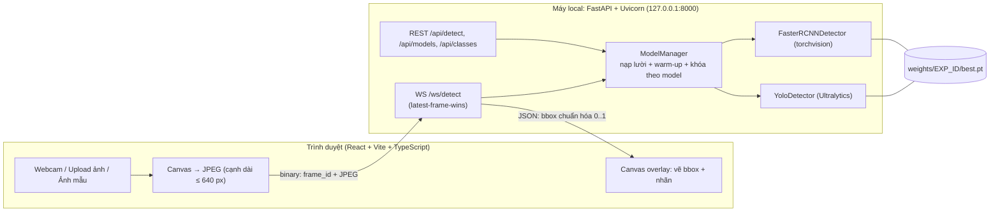

# 🍅 Tomato Leaf Detector

**Phát hiện vùng lá bệnh trên ảnh thực địa cây cà chua — web AI chạy local, live preview khoanh vùng bệnh theo thời gian thực.**

Đồ án môn học · Phát hiện đối tượng (Object Detection) · YOLO11 / YOLOv8 / Faster R-CNN · Dataset PlantDoc (Singh et al., 2020)

> ⚠️ Kết quả của hệ thống chỉ mang tính tham khảo học thuật, không thay thế chẩn đoán của chuyên gia bảo vệ thực vật.

<!-- TODO: thêm docs/demo.gif (live preview) sau khi hoàn thành Phase 5 -->

**Tài liệu đi kèm:** [PLAN.md](PLAN.md) (kế hoạch + thiết kế thí nghiệm) · [AGENT.md](AGENT.md) (luật + hợp đồng giao diện cho AI Agent) · [PROMPT.md](PROMPT.md) (bộ prompt giao việc cho AI Agent) · [docs/DEPLOYMENT.md](docs/DEPLOYMENT.md) (đưa app từ localhost lên online bằng Render)

---

## Mục lục

1. Tổng quan
2. Tính năng
3. Quyết định kỹ thuật đã chốt
4. Dataset: PlantDoc
5. Cấu trúc dự án
6. Thư viện & công cụ
7. Cài đặt & chạy nhanh
8. Huấn luyện & đánh giá
9. API
10. Kết quả
11. Hạn chế
12. Xử lý sự cố
13. Giấy phép, trích dẫn, ghi nhận

---

## 1. Tổng quan

**Bài toán.** Với một ảnh (hoặc khung hình webcam) chụp lá cà chua ngoài thực địa, mô hình trả về các **hộp bao (bounding box)** quanh vùng lá, kèm **nhãn bệnh** và **độ tin cậy**. Giao diện web vẽ các hộp này chồng lên video ngay khi đang quay (**live preview**). Toàn bộ suy luận chạy trên máy của bạn (localhost), không gửi ảnh ra ngoài.

> **Về nhãn:** trong PlantDoc, mỗi hộp bao **cả một lá (hoặc cụm lá)** và gắn tên bệnh, không bao từng đốm bệnh. "Vùng lá bệnh" trong đồ án nghĩa là vùng lá được gán nhãn bệnh.

**Câu hỏi nghiên cứu**

- **RQ1:** Khởi tạo từ trọng số COCO so với huấn luyện từ đầu (scratch) ảnh hưởng thế nào đến mAP khi dữ liệu nhỏ?
- **RQ2:** YOLO11s, YOLOv8s và Faster R-CNN đánh đổi độ chính xác và tốc độ ra sao?
- **RQ3:** Lớp nào, cặp lớp nào bị nhầm nhiều nhất; lỗi đến từ định vị, phân loại hay nhãn nhiễu?

**Sản phẩm:** (1) pipeline dữ liệu và huấn luyện tái lập được; (2) một cấu hình YOLO11s COCO-pretrained với metrics validation/test thật; (3) báo cáo per-class AP, confusion matrix và hạn chế dữ liệu; (4) web app local có live preview.

> **Phạm vi đã hoàn thành:** MVP Phase 0–6 với model **`yolo11s_coco`**, thực thi bằng run smoke có kiểm soát trên CPU (`runs/yolo11s_coco_smoke`, 10 epoch `imgsz=320`). Ma trận nghiên cứu 6 cấu hình × 3 seed (YOLOv8s, Faster R-CNN, scratch) là phần **mở rộng, chưa triển khai**; RQ1 và RQ2 hiện chưa có dữ liệu trả lời. Xem mục 10 để biết số đo thật và mục 11 để biết hạn chế.

---

## 2. Tính năng

- **Live preview webcam:** khung hình gửi qua WebSocket, hộp bao + nhãn + độ tin cậy vẽ chồng lên video.
- **Upload ảnh** hoặc chọn ảnh mẫu, xem kết quả tức thì.
- **Chọn mô hình** trong allowlist local. MVP hiện chỉ đăng ký `yolo11s_coco`; selector hiển thị đúng trạng thái available/unavailable thay vì giả lập model khác.
- **Điều chỉnh:** ngưỡng tin cậy, ngưỡng NMS, kích thước ảnh (chất lượng ↔ tốc độ), lọc lớp, ẩn "lá khỏe".
- **Thống kê:** FPS, độ trễ suy luận, số hộp theo lớp; chụp snapshot có hộp bao.
- **Offline-first:** sau lần tải trọng số đầu tiên, chạy hoàn toàn không cần mạng.

---

## 3. Quyết định kỹ thuật đã chốt

### 3.1 Bảng chốt

| Hạng mục | Quyết định |
|---|---|
| Bài toán | Object detection (bbox mức lá), **9 lớp cà chua** của PlantDoc (1 lá khỏe + 8 bệnh/sâu hại) |
| **Mô hình chính (live preview)** | **YOLO11s** (Ultralytics), fine-tune từ COCO; MVP chạy `imgsz=320` trên CPU |
| Baseline so sánh | **YOLOv8s**, **Faster R-CNN ResNet50-FPN v2** — mở rộng, **chưa triển khai** |
| Biến thể khởi tạo | MVP chỉ chạy COCO-pretrained; scratch và ma trận 6 cấu hình × 3 seed là mở rộng, **chưa chạy** |
| Backend | **FastAPI + Uvicorn**; REST + **WebSocket** (frame JPEG nhị phân); suy luận PyTorch trên CPU/CUDA/MPS |
| Frontend | **React + Vite + TypeScript**; webcam bằng `getUserMedia`, vẽ hộp bằng canvas overlay |
| Đánh giá | Evaluator chung trong repo (`src/tomato_det/eval`): mAP@.5, mAP@.5:.95, AP theo lớp, precision/recall, confusion matrix; test chỉ chạy sau evaluation lock |
| Dữ liệu | PlantDoc detection; `TEST` chính thức giữ nguyên; `val` tách từ `TRAIN` theo nhóm ảnh trùng |
| Điều khiển | CLI `tdet` (Typer) + cấu hình YAML |

### 3.2 Vì sao chọn như vậy

- **YOLO11s làm mô hình chính:** đủ nhẹ cho live preview, cỡ `s` hợp với tập dữ liệu nhỏ, hệ sinh thái Ultralytics gói sẵn train/val/export. Đề bài yêu cầu YOLOv8/YOLO11 nên giữ hai họ này.
- **Faster R-CNN làm đối chứng hai giai đoạn:** thường mạnh hơn về recall nhưng chậm hơn, phù hợp để phân tích đánh đổi tốc độ ↔ chính xác.
- **Suy luận phía server local thay vì trong trình duyệt:** chạy được cả Faster R-CNN lẫn YOLO bằng một giao diện `Detector`, dễ đo latency và đổi mô hình. ONNX Runtime Web là hướng mở rộng (xem PLAN.md §7).
- **WebSocket + "latest-frame-wins":** server luôn xử lý khung mới nhất, bỏ khung cũ, nên hình không bị trễ dồn.
- **Chốt trước khi có thực nghiệm:** nếu một cấu hình khác vượt YOLO11s ≥ 2 điểm mAP@.5:.95 (val) trong giới hạn latency, đổi `default_model` theo quy tắc ở PLAN.md §4.
- **Về YOLO26:** Ultralytics đã phát hành YOLO26 (01/2026). Đồ án giữ YOLO11/YOLOv8 theo đề bài; YOLO26s là cấu hình mở rộng tùy chọn.

### 3.3 Kiến trúc hệ thống



**Pipeline dữ liệu → mô hình:**

```
PlantDoc (30 lớp) → lọc 9 lớp cà chua → pHash dedupe → split (val từ TRAIN, test = TEST)
  → export YOLO + COCO → train YOLO11s COCO-pretrained (MVP: 1 cấu hình)
  → predictions val → evaluator chung → chọn threshold → freeze → test một lần
  → báo cáo per-class/confusion → weights/ → web app
```

### 3.4 Luồng live preview

1. Trình duyệt mở webcam, mỗi lượt vẽ khung hình vào canvas ẩn, thu nhỏ (cạnh dài ≤ 640 px), mã hóa JPEG (chất lượng ~0,7).
2. Gửi nhị phân: `[uint32 big-endian frame_id][bytes JPEG]`. Chỉ gửi khung tiếp theo sau khi nhận kết quả khung trước (stop-and-wait, tối đa 1 khung đang bay).
3. Server giải mã, suy luận trong thread pool, trả JSON gồm hộp **chuẩn hóa 0..1** (xyxy), lớp, điểm, `inference_ms`.
4. Client nhân tọa độ với kích thước video **đang hiển thị** (có tính letterbox của `object-fit`) và vẽ lên canvas overlay.

---

## 4. Dataset: PlantDoc

### 4.1 Thông tin

| Mục | Nội dung |
|---|---|
| Nguồn | Singh et al., *PlantDoc: A Dataset for Visual Plant Disease Detection*, CoDS-COMAD 2020 |
| Repo detection | https://github.com/pratikkayal/PlantDoc-Object-Detection-Dataset |
| Quy mô theo bài báo | 2.598 ảnh, 13 loài, tối đa 17 lớp bệnh; ảnh thu thập từ internet, gán nhãn thủ công |
| Bản detection | Thư mục `TRAIN/`, `TEST/` + `train_labels.csv`, `test_labels.csv`; **30 lớp đối tượng** (gồm lá khỏe) |
| Giấy phép | CC BY 4.0 (bắt buộc ghi nguồn) |
| Dùng trong đồ án | Chỉ **9 lớp cà chua** của bản detection |

> Số ảnh train/test có thể lệch nhẹ giữa các nguồn (bài báo: 2.360/238; một bản resize bên thứ ba: 2.328/237). **Dùng số liệu do `tdet data inspect` đếm trên bản bạn tải về.** `train_labels.csv` có khoảng 8,4 nghìn dòng cho cả 30 lớp. Số ảnh/hộp riêng cho cà chua chưa biết trước; ước tính vài trăm đến khoảng một nghìn ảnh.

### 4.2 Chín lớp cà chua

Nguồn sự thật duy nhất: `configs/classes.yaml` (thứ tự `id` = thứ tự lớp của YOLO).

| id | Tên trong PlantDoc | slug | Tên tiếng Việt (tham khảo) | Nhóm |
|---|---|---|---|---|
| 0 | `Tomato Early blight leaf` | `early_blight` | Úa sớm (đốm vòng) | fungal_oomycete |
| 1 | `Tomato Septoria leaf spot` | `septoria_leaf_spot` | Đốm lá Septoria | fungal_oomycete |
| 2 | `Tomato leaf bacterial spot` | `bacterial_spot` | Đốm vi khuẩn | bacterial |
| 3 | `Tomato leaf late blight` | `late_blight` | Mốc sương (úa muộn) | fungal_oomycete |
| 4 | `Tomato leaf mosaic virus` | `mosaic_virus` | Virus khảm | viral |
| 5 | `Tomato leaf yellow virus` | `yellow_virus` | Virus vàng/xoăn lá | viral |
| 6 | `Tomato mold leaf` | `leaf_mold` | Mốc lá | fungal_oomycete |
| 7 | `Tomato two spotted spider mites leaf` | `spider_mites` | Nhện hai chấm | pest |
| 8 | `Tomato leaf` | `healthy` | Lá khỏe | healthy |

Tên lớp lấy từ danh sách lớp của bản detection; tên tiếng Việt chỉ để hiển thị, cần đối chiếu tài liệu bảo vệ thực vật trước khi dùng trong báo cáo. `tdet data inspect` phải kiểm tra lại tên lớp thật trong file nhãn (chữ hoa/thường, khoảng trắng).

### 4.3 Quy trình xử lý

1. Đọc CSV (hoặc XML VOC nếu có) → bảng ảnh/hộp; chuẩn hóa tên lớp.
2. Ánh xạ 30 → 9 lớp; bỏ hộp loài khác; giữ ảnh có ≥ 1 hộp cà chua.
3. Kiểm tra: ảnh hỏng/thiếu, hộp ngoài ảnh hoặc diện tích 0, hộp trùng.
4. Phát hiện ảnh gần trùng bằng **pHash**, gom thành nhóm.
5. Chia split: `TEST` chính thức giữ nguyên; tách `val` (~15%) từ `TRAIN` bằng `StratifiedGroupKFold` (seed 42) theo nhóm trùng. Ảnh train/val trùng với ảnh test bị loại khỏi train/val.
6. Xuất YOLO `.txt` và COCO `.json`; lưu danh sách split vào `data/splits/*.txt` (được commit để tái lập).
7. Sinh thống kê và ảnh kiểm tra bằng mắt.

### 4.4 Lưu ý chất lượng dữ liệu

Dữ liệu nhỏ, mất cân bằng lớp (một bài phân tích bên thứ ba ghi khoảng 50–180 ảnh mỗi lớp), nhãn nhiễu, nhiều lá trong một ảnh, nền phức tạp, ảnh internet có thể trùng. **mAP thấp là bình thường**, vì vậy phân tích lỗi theo lớp là phần trọng tâm.

Để định cỡ kỳ vọng: một bài hướng dẫn bên thứ ba huấn luyện Faster R-CNN R50-FPN v2 trên toàn bộ PlantDoc 30 lớp (ảnh resize 416) báo mAP@[.5:.95] ≈ 0,40 và mAP@0,5 ≈ 0,53 trên tập test ([nguồn](https://debuggercafe.com/plant-disease-detection-using-plantdoc/)). Đây không phải kết quả của đồ án này.

> Ảnh PlantDoc là ảnh thu thập từ internet, **không đưa ảnh dataset vào repo công khai**. `data/samples/` chỉ chứa ảnh tự chụp hoặc ảnh có giấy phép rõ ràng.

---

## 5. Cấu trúc dự án

```
tomato-leaf-detector/
├── README.md                        # tài liệu này
├── PLAN.md                          # kế hoạch, thiết kế thí nghiệm, checklist
├── AGENT.md                         # luật + hợp đồng giao diện cho AI Agent
├── PROMPT.md                        # bộ prompt giao việc cho AI Agent
├── LICENSE                          # AGPL-3.0 (do phụ thuộc Ultralytics)
├── pyproject.toml                   # metadata gói, cấu hình ruff/pytest, entry point `tdet`
├── requirements.txt                 # runtime (backend + CLI)
├── requirements-train.txt           # huấn luyện + đánh giá
├── requirements-dev.txt             # test + lint
├── .env.example                     # biến môi trường TDET_*
├── .gitignore
├── .github/workflows/ci.yml         # ruff + pytest + build frontend
│
├── configs/
│   ├── classes.yaml                 # NGUỒN SỰ THẬT về 9 lớp (id, tên PlantDoc, slug, tên VI, nhóm, màu)
│   ├── data.yaml                    # đường dẫn dữ liệu, tỉ lệ split, seed, ngưỡng pHash
│   ├── eval.yaml                    # conf=0.001, nms_iou=0.6, operating_iou=0.5, max_det=100
│   ├── app.yaml                     # model phục vụ, default_model, mặc định live (conf/iou/imgsz)
│   └── experiments/
│       ├── yolo11s_coco.yaml        # cấu hình đầy đủ (100 epoch, imgsz 640) — chưa chạy trên CPU
│       └── yolo11s_coco_smoke.yaml  # cấu hình MVP đã chạy (10 epoch, imgsz 320)
│
├── data/                            # git-ignore, chỉ track data/splits/ và data/samples/README.md
│   ├── README.md                    # nguồn, giấy phép, cách tải
│   ├── raw/plantdoc/                # clone PlantDoc-Object-Detection-Dataset (TRAIN/, TEST/, *_labels.csv)
│   ├── interim/                     # bản ghi trung gian, hash ảnh
│   ├── processed/
│   │   ├── tomato_yolo/             # images/{train,val,test}, labels/{train,val,test}, dataset.yaml
│   │   └── tomato_coco/             # annotations/{train,val,test}.json (trỏ về ảnh của tomato_yolo)
│   ├── splits/                      # train.txt, val.txt, test.txt (TRACKED)
│   └── samples/                     # ảnh demo tự chụp / có giấy phép rõ ràng
│
├── src/tomato_det/
│   ├── cli.py                       # Typer: data|train|eval|eval-artifacts|predict|choose-threshold|freeze-eval|report|bench|serve
│   ├── common/
│   │   ├── classes.py               # đọc classes.yaml → ClassSpec
│   │   ├── types.py                 # ImageRecord, BoxRecord
│   │   ├── config.py                # nạp YAML
│   │   ├── paths.py  seed.py  device.py
│   │   └── meta.py                  # git hash (nếu có), phiên bản thư viện → meta.json
│   ├── data/
│   │   ├── inspect.py               # thống kê raw, phát hiện lỗi
│   │   ├── parse_plantdoc.py        # CSV → ImageRecord
│   │   ├── tomato_subset.py         # ánh xạ 30→9 lớp, lọc ảnh/hộp
│   │   ├── dedup.py                 # pHash, gom nhóm trùng
│   │   ├── split.py                 # split theo group, seed cố định
│   │   ├── export_yolo.py  export_coco.py
│   │   └── stats.py  visualize.py
│   ├── models/
│   │   ├── base.py                  # Protocol Detector + Detection chuẩn hóa
│   │   ├── yolo_detector.py         # adapter Ultralytics
│   │   └── registry.py              # allowlist model → checkpoint local
│   ├── train/
│   │   └── train_yolo.py            # preflight, train, ghi meta.json
│   ├── eval/
│   │   ├── metrics.py               # AP/precision/recall/confusion matrix
│   │   ├── artifacts.py             # đọc COCO, evaluation lock, gate test
│   │   ├── predictions.py           # xuất prediction pixel xyxy
│   │   ├── operating_point.py       # chọn conf theo F1 trên val
│   │   ├── evaluate.py              # val nhanh qua Ultralytics
│   │   ├── benchmark_latency.py     # warm-up, P50/P95
│   │   └── report.py                # → reports/tables, reports/figures, REPORT.md
│   └── serving/
│       ├── main.py                  # create_app(), mount frontend/dist
│       ├── settings.py              # pydantic-settings (TDET_*)
│       ├── schemas.py               # Pydantic response/WS messages
│       ├── routers/                 # health.py classes.py models.py detect.py stream.py
│       ├── services/                # model_manager.py inference.py
│       └── utils/image_io.py
│
│   # Chưa triển khai (mở rộng): models/frcnn_*, train/train_frcnn.py, train/run_matrix.py,
│   # eval/confusion.py, eval/error_analysis.py, eval/bootstrap.py, data/torch_dataset.py,
│   # export/export_onnx.py
│
├── frontend/
│   ├── package.json  tsconfig.json  vite.config.ts  index.html
│   ├── src/
│   │   ├── main.tsx  App.tsx
│   │   ├── api/                     # client.ts  wsClient.ts  types.ts
│   │   ├── hooks/                   # useWebcam.ts  useDetectionStream.ts  useFps.ts
│   │   ├── components/              # VideoStage  OverlayCanvas  ControlsPanel  ModelSelector
│   │   │                            # ResultList  StatsBar  Legend  Disclaimer  UploadDropzone
│   │   ├── pages/                   # LivePage  UploadPage  AboutPage
│   │   ├── lib/                     # drawBoxes.ts (letterbox-aware)  frameEncoder.ts  colors.ts
│   │   └── styles/app.css           # không dùng CDN/font ngoài
│   └── tests/                       # drawBoxes.test.ts  protocol.test.ts  apiTypes.test.ts
│
├── tests/                           # pytest: data, split, detector, API, WS, metrics, predictions, training
├── scripts/                         # extract_plantdoc_windows.py, ws_smoke_test.py
├── start_demo.bat                   # one-click: build frontend + chọn port + mở trình duyệt
├── runs/                            # git-ignore: log + checkpoint huấn luyện
├── weights/                         # git-ignore *.pt: weights/<exp_id>/best.pt + README.md
├── reports/                         # sinh tự động: metrics_summary.csv, per_class_metrics.csv, confusion_matrix.csv, figures/, REPORT.md
└── docs/                            # ảnh minh họa, API.md, ADR bổ sung
```

---

## 6. Thư viện & công cụ

**Python 3.10–3.12 · Node.js ≥ 22 LTS.** Cài PyTorch riêng theo [pytorch.org](https://pytorch.org/get-started/locally/) (chọn CUDA hoặc CPU) **trước** khi cài các gói dưới đây. Dưới đây là cận dưới tương thích; sau lần cài thành công đầu tiên, chạy `pip freeze > requirements.lock.txt` để khóa phiên bản.

| Nhóm | Thư viện | Cận dưới gợi ý | Dùng để |
|---|---|---|---|
| Deep learning | `torch`, `torchvision` | 2.x (cài theo pytorch.org) | Faster R-CNN, tiền xử lý, suy luận |
| Detection | `ultralytics` | `>=8.3,<9` | YOLO11 / YOLOv8: train, val, predict, export |
| Backend | `fastapi` | `>=0.115` | REST + WebSocket |
| | `uvicorn[standard]` | `>=0.30` | ASGI server (kèm `websockets`) |
| | `python-multipart` | `>=0.0.9` | upload ảnh |
| | `pydantic`, `pydantic-settings` | `>=2.7`, `>=2.3` | schema, cấu hình `TDET_*` |
| CLI / cấu hình | `typer`, `pyyaml` | `>=0.12`, `>=6` | lệnh `tdet`, đọc YAML |
| Ảnh / số | `numpy`, `pillow` | `>=1.26`, `>=10.3` | xử lý ảnh |
| | OpenCV | kéo theo bởi `ultralytics` | giải mã/mã hóa JPEG, vẽ bbox (**không** cài thêm `opencv-python-headless` để tránh xung đột) |
| Đánh giá | `torchmetrics`, `pycocotools` | `>=1.4`, `>=2.0.7` | mAP kiểu COCO |
| Dữ liệu | `scikit-learn`, `pandas`, `imagehash`, `tqdm` | `>=1.4`, `>=2.2`, `>=4.3`, `>=4.66` | split theo nhóm, thống kê, pHash |
| Báo cáo | `matplotlib` | `>=3.8` | biểu đồ, confusion matrix |
| Xuất mô hình (tùy chọn) | `onnx`, `onnxruntime` | mới nhất tương thích | ONNX, benchmark |
| Dev | `pytest`, `httpx`, `ruff` | `>=8`, `>=0.27`, `>=0.5` | test, TestClient, lint |
| Frontend | `react`, `react-dom` | `^18.3` hoặc `^19` | UI |
| | `vite`, `@vitejs/plugin-react`, `typescript` | bản ổn định mới nhất | build, dev server |
| | `vitest`, `eslint` | bản ổn định mới nhất | test, lint |

---

## 7. Cài đặt & chạy nhanh

**Yêu cầu:** Python 3.10–3.12, Node.js ≥ 22 LTS, webcam (cho live preview). GPU NVIDIA là tùy chọn khi huấn luyện; chưa có GPU thì huấn luyện trên Colab/Kaggle, còn chạy web trên CPU vẫn được.

```bash
git clone <repo-url> tomato-leaf-detector && cd tomato-leaf-detector
python -m venv .venv
source .venv/bin/activate            # Windows: .venv\Scripts\activate

# 1) Cài PyTorch theo https://pytorch.org/get-started/locally/ (CUDA hoặc CPU)
# 2) Cài phần còn lại
pip install -r requirements.txt -r requirements-train.txt -r requirements-dev.txt
pip install -e . --no-deps
yolo settings sync=False             # tắt thống kê ẩn danh của Ultralytics (giữ offline)

# 3) Dữ liệu
git clone --depth 1 https://github.com/pratikkayal/PlantDoc-Object-Detection-Dataset data/raw/plantdoc
tdet data inspect                    # thống kê + kiểm tra tên lớp
tdet data prepare                    # lọc cà chua → dedupe → split → export YOLO/COCO

# 4) Huấn luyện + đánh giá (CPU: dùng cấu hình smoke; GPU: yolo11s_coco)
tdet train --exp yolo11s_coco_smoke --seed 42
tdet eval  --exp yolo11s_coco_smoke --split val

# 5) Chạy web app
cd frontend && npm ci && npm run build && cd ..
tdet serve                           # mở http://127.0.0.1:8000
# hoặc trên Windows: .\start_demo.bat  (tự build + tự chọn port 8000–8010)
```

### Chuẩn bị dữ liệu Phase 1 trên Windows

Tạo môi trường rồi cài PyTorch phù hợp CPU/CUDA theo trang PyTorch trước khi cài các requirements
còn lại:

```powershell
py -3.12 -m venv .venv
.\.venv\Scripts\Activate.ps1
# Cài torch + torchvision theo lệnh do pytorch.org tạo cho CPU hoặc CUDA của máy.
python -m pip install -r requirements.txt -r requirements-train.txt -r requirements-dev.txt
python -m pip install -e . --no-deps
tdet --help
```

Tải thủ công PlantDoc Object Detection Dataset theo hướng dẫn trong [data/README.md](data/README.md).
Không chạy `tdet data prepare` trước khi xem báo cáo `tdet data inspect`: lệnh inspect không sửa ảnh
hay nhãn, còn prepare sẽ từ chối ghi đè output export đang tồn tại. Pipeline ghi lỗi ảnh/box và class
ngoài mapping vào `data/interim/prepare_report.json`, loại ảnh TRAIN gần trùng với TEST, giữ nguyên
TEST nguồn, rồi tạo manifest tái lập ở `data/splits/`.

```powershell
tdet data inspect
tdet data prepare
```

### Huấn luyện YOLO11s Phase 2

Phase 2 dùng [configs/experiments/yolo11s_coco.yaml](configs/experiments/yolo11s_coco.yaml) cho cấu
hình đầy đủ. Cài `torch`, `torchvision` và `ultralytics` trước; sau đó tự tải COCO-pretrained
`yolo11s.pt` từ nguồn Ultralytics chính thức và đặt tại `weights/bootstrap/yolo11s.pt`. Lệnh train
không tải weight tự động.

Máy dùng để hoàn thiện MVP **chỉ có CPU** (Intel i5-11400H, 6 core/12 thread, 16 GB RAM, không CUDA),
nên cấu hình 100 epoch `imgsz=640` không khả thi. MVP dùng
[configs/experiments/yolo11s_coco_smoke.yaml](configs/experiments/yolo11s_coco_smoke.yaml):
10 epoch, `imgsz=320`, `batch=4`, `workers=0`. Đây là checkpoint **thật** nhưng ngắn, và mọi metric
trong mục 10 được báo cáo đúng với giới hạn đó.

```powershell
# MVP trên CPU (đã dùng để sinh kết quả trong mục 10)
tdet train --exp yolo11s_coco_smoke --seed 42

# Cấu hình đầy đủ cho máy có GPU
tdet train --exp yolo11s_coco --seed 42

# Copy checkpoint của chính run vừa train vào vị trí app đọc
Copy-Item runs\yolo11s_coco_smoke\weights\best.pt weights\yolo11s_coco\best.pt -Force
```

`tdet train` từ chối ghi vào `runs/<exp_id>` đang có file; hãy đổi tên hoặc xoá run cũ trước khi train
lại. Khi chỉ muốn chạy nhanh giao diện, dùng `start_demo.bat` (tự build frontend, tự chọn port trống
8000–8010 và mở trình duyệt).

### Đánh giá và báo cáo Phase 6

Không có số liệu nào được tạo khi thiếu dữ liệu, checkpoint hoặc prediction artifact. Sau khi đã chạy
validation và chọn checkpoint/ngưỡng bằng **val**, xuất prediction của đúng checkpoint ở toạ độ pixel
`xyxy` theo schema `{"predictions": [{"image_id", "class_id", "score", "box"}]}` rồi chạy:

```powershell
# 1) Xuất prediction của đúng checkpoint trên val (pixel xyxy, conf thấp cho AP)
tdet predict --exp yolo11s_coco_smoke --checkpoint runs/yolo11s_coco_smoke/weights/best.pt `
  --split val --output runs/yolo11s_coco_smoke/predictions_val.json `
  --conf 0.001 --iou 0.6 --image-size 320

# 2) Chọn ngưỡng vận hành bằng F1 trên val (không dùng test)
tdet choose-threshold --annotations data/processed/tomato_coco/annotations/val.json `
  --predictions runs/yolo11s_coco_smoke/predictions_val.json `
  --output runs/yolo11s_coco_smoke/operating_point.json
$op = (Get-Content runs/yolo11s_coco_smoke/operating_point.json | ConvertFrom-Json).operating_point.threshold

# 3) Chấm validation: AP từ conf thấp, precision/recall/confusion tại ngưỡng vận hành
tdet eval-artifacts --annotations data/processed/tomato_coco/annotations/val.json `
  --predictions runs/yolo11s_coco_smoke/predictions_val.json `
  --operating-threshold $op `
  --output runs/yolo11s_coco_smoke/metrics_val.json

# 4) Chỉ sau khi chốt checkpoint/cấu hình theo validation: khóa cặp checkpoint + data YAML
tdet freeze-eval --checkpoint runs/yolo11s_coco_smoke/weights/best.pt `
  --data-yaml data/processed/tomato_yolo/dataset.yaml `
  --validation-metrics runs/yolo11s_coco_smoke/metrics_val.json `
  --output runs/yolo11s_coco_smoke/evaluation_lock.json

# 5) TEST cuối cùng bắt buộc phải có lock khớp checkpoint và dataset YAML
tdet predict --exp yolo11s_coco_smoke --checkpoint runs/yolo11s_coco_smoke/weights/best.pt `
  --split test --output runs/yolo11s_coco_smoke/predictions_test.json `
  --conf 0.001 --iou 0.6 --image-size 320
tdet eval-artifacts --split test --annotations data/processed/tomato_coco/annotations/test.json `
  --predictions runs/yolo11s_coco_smoke/predictions_test.json `
  --operating-threshold $op `
  --checkpoint runs/yolo11s_coco_smoke/weights/best.pt `
  --data-yaml data/processed/tomato_yolo/dataset.yaml `
  --evaluation-lock runs/yolo11s_coco_smoke/evaluation_lock.json `
  --output runs/yolo11s_coco_smoke/metrics_test.json

# 6) Latency inference-only, có warm-up (cùng imgsz với demo)
tdet bench --checkpoint runs/yolo11s_coco_smoke/weights/best.pt `
  --image data/raw/plantdoc/TEST/0.jpg --device cpu --image-size 320 `
  --output reports/latency.json

# 7) Bảng CSV, REPORT.md và PNG (cần matplotlib); --no-figures chỉ tạo bảng/report
tdet report --metrics runs/yolo11s_coco_smoke/metrics_test.json `
  --validation-metrics runs/yolo11s_coco_smoke/metrics_val.json `
  --operating-point runs/yolo11s_coco_smoke/operating_point.json `
  --latency reports/latency.json `
  --dataset-report data/interim/prepare_report.json `
  --output-dir reports
```

`eval-artifacts` từ chối ghi đè artifact đã tồn tại: xoá file metrics/prediction cũ trước khi chạy lại.
`bench` cần một ảnh local tồn tại; nếu không có ảnh tự chụp trong `data/samples/`, dùng một ảnh PlantDoc
đã tải về (không commit ảnh đó).

`tdet bench` đo inference-only sau warm-up và lưu P50/P95 cùng device, số lượt đo và input; không đo
thời gian webcam/JPEG/network. Báo cáo tự động nêu rõ giới hạn PlantDoc và domain gap webcam, nhưng chỉ
điền số từ JSON metrics đã đo.

### Backend REST Phase 3

Backend chỉ bind loopback. Sau khi cài runtime requirements, chạy trên Windows PowerShell:

```powershell
.\.venv\Scripts\Activate.ps1
python -m pip install -r requirements.txt
uvicorn tomato_det.serving.main:app --host 127.0.0.1 --port 8000
```

Mở `http://127.0.0.1:8000/api/health`, `api/classes`, hoặc `api/models`. Endpoint `POST /api/detect`
nhận multipart field `file`; khi chưa có `weights/yolo11s_coco/best.pt`, nó trả `MODEL_UNAVAILABLE`
thay vì sinh dự đoán. Chi tiết request/response ở [docs/API.md](docs/API.md).

`WS /ws/detect` dùng gói JPEG binary + `frame_id` với stop-and-wait ở client và one-frame
latest-frame-wins ở server. Frontend vẽ box chuẩn hóa theo vùng ảnh thực tế của `object-fit: contain`,
kể cả khi có letterbox. Cần một checkpoint hợp lệ và quyền webcam để kiểm thử live preview trong trình
duyệt.

### Kiểm tra đúng loại cây

YOLO bệnh lá chỉ được huấn luyện trên các lớp cà chua nên không thể tự suy ra đáng tin cậy rằng một lá
tương tự thuộc cây khác. Ứng dụng dùng một **tomato gate** tách biệt trước detector. Khi đặt checkpoint
phân loại local tại `weights/tomato_gate/best.pt`, với hai lớp `tomato_leaf` và `other`, backend sẽ trả
`rejected` và thông báo nhập ảnh khác cho ảnh không được xác nhận là lá cà chua. Khi checkpoint gate chưa
có, API trả `unverified` một cách trung thực; không dùng heuristic màu xanh để giả định loại cây.

Checkpoint gate cần được train với ảnh lá cà chua dương tính và ảnh âm tính đa dạng (lá cây khác, cỏ,
đất, tay, vật thể nền), tách validation/test theo ảnh và đánh giá false-accept/false-reject trước khi bật
trong demo. Mọi hướng xử lý theo bệnh trên giao diện chỉ là gợi ý IPM học thuật, không có liều lượng hoặc
khuyến cáo thuốc; cần xác nhận thực địa trước khi can thiệp.

Chỉ muốn chạy demo: đặt trọng số vào `weights/<exp_id>/best.pt` rồi chạy bước 5. Khi thiếu trọng số, UI hiển thị mô hình tương ứng là "chưa có" thay vì lỗi.

### Frontend Phase 5 trên Windows

Lần đầu trong thư mục `frontend`, cài Node.js 22 LTS hoặc mới hơn, rồi tạo lockfile và cài dependency:

```powershell
cd frontend
npm install
npm run test -- --run
npm run build
cd ..
```

Sau khi đã có `package-lock.json`, dùng `npm ci` để cài tái lập được. Bản production được FastAPI phục
vụ tại `http://127.0.0.1:8000/` khi `frontend/dist` tồn tại. Trong lúc phát triển, chạy hai terminal:

```powershell
# Terminal 1: backend
.\.venv\Scripts\Activate.ps1
uvicorn tomato_det.serving.main:app --host 127.0.0.1 --port 8000 --reload

# Terminal 2: frontend (Vite proxy /api và /ws về backend)
cd frontend
npm run dev
```

Mở địa chỉ Vite mà lệnh in ra (mặc định `http://127.0.0.1:5173`). Khi chưa có
`weights/yolo11s_coco/best.pt`, frontend hiển thị model là chưa sẵn sàng; upload và webcam không gửi
frame suy luận cho đến khi checkpoint được đặt đúng đường dẫn.

Biến môi trường (xem `.env.example`): `TDET_DEVICE` (`auto|cpu|cuda:0|mps`), `TDET_DEFAULT_MODEL`, `TDET_HOST` (mặc định `127.0.0.1`), `TDET_PORT`, `TDET_MAX_FRAME_BYTES`, `TDET_MAX_LOADED_MODELS`, `TDET_LOG_LEVEL`.

---

## 8. Huấn luyện & đánh giá

### 8.1 Cấu hình đã chạy

| Exp ID | Kiến trúc | Khởi tạo | Epochs | imgsz | Batch | Device | Seed |
|---|---|---|---|---|---|---|---|
| `yolo11s_coco_smoke` | YOLO11s | COCO (`yolo11s.pt`) | 10 | 320 | 4 | CPU | 42 |

Config đầy đủ cho máy có GPU nằm ở `configs/experiments/yolo11s_coco.yaml` (100 epoch, `imgsz=640`),
nhưng **chưa được chạy** trên máy CPU này. Ma trận mở rộng 6 cấu hình × 3 seed (YOLOv8s, Faster R-CNN,
scratch) **chưa được triển khai**; xem PLAN.md §4.2.

### 8.2 Lệnh

Các lệnh dưới đây là những lệnh **đã được implement và kiểm thử**:

```powershell
tdet data inspect                                  # thống kê + kiểm tra dữ liệu raw
tdet data prepare                                  # lọc, dedupe, split, export YOLO + COCO
tdet train --exp yolo11s_coco_smoke --seed 42      # train thật (CPU, cấu hình smoke)
tdet eval --exp yolo11s_coco_smoke --split val     # val nhanh qua Ultralytics → metrics_val_ultralytics.json
tdet predict --exp yolo11s_coco_smoke --split val  # prediction artifact cho evaluator chung
tdet eval-artifacts --annotations ... --predictions ... --output ...
tdet choose-threshold --annotations ... --predictions ... --output ...
tdet freeze-eval --checkpoint ... --data-yaml ... --validation-metrics ... --output ...
tdet report --metrics ... --output-dir reports
tdet bench --checkpoint ... --image ... --device cpu --output reports/latency.json
tdet serve                                         # backend + frontend build tại 127.0.0.1
```

`tdet train-all`, `tdet analyze`, `tdet export` và các adapter Faster R-CNN/YOLOv8s trong PLAN.md là
**hợp đồng mục tiêu của phần mở rộng**, hiện chưa có trong CLI.

### 8.3 Nguyên tắc đánh giá

- Mọi mô hình trong allowlist phải được chấm bằng **cùng một evaluator** với `conf=0.001`, `nms_iou=0.6`, `max_det=100`.
- Chọn checkpoint, siêu tham số và ngưỡng `conf` vận hành **chỉ bằng tập `val`**. Tập `test` chỉ chạy khi chốt kết quả cuối và khoá checkpoint/dataset.
- MVP chạy **một seed** và **chưa implement** bootstrap confidence interval; vì vậy báo cáo nêu rõ đây là số đo một lần chạy, không phải trung bình ± độ lệch chuẩn.

---

## 9. API

| Method | Đường dẫn | Mô tả |
|---|---|---|
| GET | `/api/health` | trạng thái, thiết bị (`cpu`/`cuda:0`/`mps`), model đã nạp |
| GET | `/api/classes` | 9 lớp: `id`, `slug`, `name_vi`, `group`, `color` |
| GET | `/api/models` | danh sách mô hình, trạng thái `available`, chỉ số val nếu có |
| POST | `/api/detect` | upload ảnh (`multipart/form-data`, trường `file`); query: `model`, `conf`, `iou`, `imgsz`, `max_det` |
| WS | `/ws/detect` | live preview |

**WebSocket** (chi tiết ở AGENT.md §6.3):

- Client → server (text, gửi khi kết nối và mỗi khi đổi cài đặt):
  `{"type":"config","model":"yolo11s_coco","conf":0.25,"iou":0.5,"imgsz":640,"max_det":50,"agnostic_nms":true}`
- Client → server (binary): `[uint32 big-endian frame_id][JPEG bytes]`
- Server → client:

```json
{
  "type": "result",
  "frame_id": 128,
  "model": "yolo11s_coco",
  "image": {"width": 640, "height": 480},
  "inference_ms": 18.7,
  "detections": [
    {"class_id": 3, "class_name": "late_blight", "score": 0.81, "box": [0.12, 0.20, 0.55, 0.77]}
  ]
}
```

`box` là `[x1, y1, x2, y2]` chuẩn hóa 0..1 theo kích thước khung đã gửi. Lỗi trả về `{"type":"error","code":"INVALID_IMAGE|MODEL_NOT_FOUND|PAYLOAD_TOO_LARGE|INFERENCE_FAILED","message":"..."}`.

---

## 10. Kết quả

> Bảng này được điền từ `reports/metrics_summary.csv` và `reports/REPORT.md` do `tdet report` sinh ra từ artifact JSON của lần chạy thật. **Không điền tay.**

| Exp ID | mAP@.5:.95 (val) | mAP@.5 (val) | mAP@.5:.95 (test) | mAP@.5 (test) | Latency P50 / P95 (ms) | Thời gian train |
|---|---|---|---|---|---|---|
| `yolo11s_coco_smoke` | 0.1251 | 0.2285 | 0.1661 | 0.2668 | 49.1 / 55.0 (imgsz 320, CPU) | 25,6 phút (10 epoch, CPU) |

Điều kiện đọc bảng: checkpoint `runs/yolo11s_coco_smoke/weights/best.pt` (epoch 9/10), seed 42,
`imgsz=320`, batch 4, CPU. AP được tính bằng evaluator chung ở `conf=0.001`, `operating_iou=0.5`,
`max_det=100`; precision/recall/confusion được tính tại ngưỡng vận hành **0.15** do `choose-threshold`
chọn trên validation (F1 = 0.3110, precision = 0.3275, recall = 0.2961 trên val).

Test đạt precision 0.2320 / recall 0.3854 tại cùng ngưỡng 0.15. Chi tiết per-class, confusion matrix,
dataset splits và hạn chế: `reports/REPORT.md`, `reports/per_class_metrics.csv`,
`reports/confusion_matrix.csv`.

Các dòng `yolo11s_coco` (100 epoch), `yolov8s_*` và `frcnn_*` **chưa được chạy**, nên không có số liệu.
Số val do Ultralytics in trong lúc train (mAP@.5 0.281) là của validator nội bộ Ultralytics; báo cáo này
dùng evaluator chung của dự án cho cả val và test nên có thể lệch nhẹ.

---

## 11. Hạn chế

- Nhãn ở mức **lá**, không phải đốm bệnh; không đo mức độ nặng nhẹ.
- Tập test cà chua nhỏ (69 ảnh / 192 box) nên mAP biến động mạnh; MVP chạy **một seed** và **chưa implement** bootstrap CI, vì vậy chỉ nên đọc số liệu như mô tả một lần chạy.
- MVP huấn luyện trên **CPU** với 10 epoch, `imgsz=320`; không đủ để kết luận so sánh kiến trúc hay đạt độ chính xác triển khai thực tế.
- Lớp `spider_mites` (id 7) gần như không có mẫu: 1 box train, 1 box val, **0 box test**; AP của lớp này không có ý nghĩa thống kê.
- Khoảng cách miền (domain gap): ảnh internet vs webcam/ảnh thực địa của bạn; live preview có thể kém ổn định hơn kết quả trên tập test.
- Một số bệnh (virus khảm, virus vàng, đốm hoại tử) có triệu chứng giống nhau, dễ nhầm.
- Hộp hiển thị trễ vài chục đến vài trăm ms so với video (độ trễ suy luận + mạng cục bộ).
- Hệ thống không đưa khuyến nghị điều trị.

---

## 12. Xử lý sự cố

| Triệu chứng | Cách xử lý |
|---|---|
| Trình duyệt không bật được webcam | Mở qua `http://localhost:8000` hoặc `127.0.0.1` (secure context). Truy cập bằng IP LAN qua HTTP sẽ bị chặn; cần HTTPS (ví dụ chứng chỉ tự ký). |
| `torch.cuda.is_available()` là `False` | Cài lại PyTorch đúng bản CUDA theo pytorch.org; kiểm tra driver NVIDIA. |
| Lần chạy đầu cần mạng | Ultralytics/torchvision tải trọng số COCO một lần. Sau đó chạy offline; chạy `yolo settings sync=False`. |
| `pycocotools` lỗi cài trên Windows | Cài Microsoft C++ Build Tools hoặc dùng WSL2. |
| Hết VRAM khi train | Giảm `batch`; với Faster R-CNN scratch giữ batch ≥ 8 (BatchNorm đang bật) hoặc dùng tích lũy gradient. |
| Live preview giật/trễ | Giảm `imgsz` (416/320), giảm chất lượng JPEG, dùng GPU, đóng ứng dụng nặng. |
| UI báo mô hình "chưa có" | Chưa có `weights/<exp_id>/best.pt`; chạy `tdet train` hoặc chép trọng số vào. |
| `frontend/dist` không tồn tại | Chạy `cd frontend && npm ci && npm run build`. |

---

## 13. Giấy phép, trích dẫn, ghi nhận

- **Mã nguồn:** AGPL-3.0, do phụ thuộc Ultralytics (AGPL-3.0). Nếu muốn giấy phép khác, cần thay Ultralytics hoặc xin giấy phép Enterprise của Ultralytics.
- **Dataset PlantDoc:** CC BY 4.0, phải ghi nguồn. Ảnh gốc được thu thập từ internet nên **không phân phối lại dataset trong repo**.
- **Trích dẫn:**

```bibtex
@inproceedings{10.1145/3371158.3371196,
  author    = {Singh, Davinder and Jain, Naman and Jain, Pranjali and Kayal, Pratik and Kumawat, Sudhakar and Batra, Nipun},
  title     = {PlantDoc: A Dataset for Visual Plant Disease Detection},
  year      = {2020},
  publisher = {ACM},
  doi       = {10.1145/3371158.3371196},
  booktitle = {Proceedings of the 7th ACM IKDD CoDS and 25th COMAD},
  pages     = {249--253}
}
```

- **Ghi nhận:** tác giả PlantDoc; Ultralytics (YOLO11/YOLOv8); PyTorch/torchvision; FastAPI; React & Vite.
